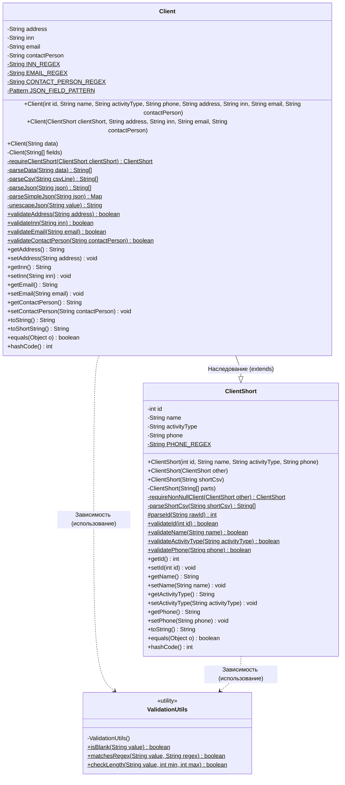

# Лабораторная работа №1. Пункт 10: Диаграмма классов UML

## Диаграмма классов предметной области (Вариант 7: Нотариальная контора)

Ниже представлена полная диаграмма классов, отображающая структуру созданных классов, модификаторы доступа (`+` public, `-` private, `#` protected), типы данных, методы валидации, перегруженные конструкторы и связь наследования.

---

### 1. UML Диаграмма (Mermaid)

---

### 2. Описание элементов диаграммы

1. **`ClientShort` (Базовый класс / Краткая модель):**
   * Хранит ключевые идентифицирующие атрибуты клиента (`id`, `name`, `activityType`, `phone`).
   * Все поля объявлены с модификатором `-` (`private`), поэтому доступ к ним извне (и даже из класса-наследника) возможен только через публичные геттеры/сеттеры с валидацией — инкапсуляция соблюдена полностью.
   * Содержит статические методы валидации базовых полей и защищённый статический парсер `parseId(...)`, переиспользуемый в `Client`.
   * Предоставляет перегруженные конструкторы: базовый, копирующий (из другого `ClientShort` или `Client`) и из краткой строки CSV.

2. **`Client` (Класс-наследник / Полная модель):**
   * Наследует `id`, `name`, `activityType`, `phone` и их геттеры/сеттеры/валидаторы от `ClientShort`.
   * Добавляет приватные поля (`-` `private`): `address`, `inn`, `email`, `contactPerson`.
   * В конструкторах вызывает `super(...)` с уже распарсенными и провалидированными базовыми данными — объект не может существовать даже временно в фиктивном состоянии.
   * Реализует перегрузку конструктора для парсинга полного CSV и JSON (с поддержкой экранированных кавычек).
   * Переопределяет `toString()` (полный отчет), `toShortString()` (делегирование в суперкласс) и `equals`/`hashCode`.

3. **`ValidationUtils` (Утилитный класс):**
   * Имеет приватный конструктор, запрещающий создание объектов.
   * Содержит статические методы (`$`), устраняющие дублирование логики регулярных выражений и проверки строк в классах предметной области.
