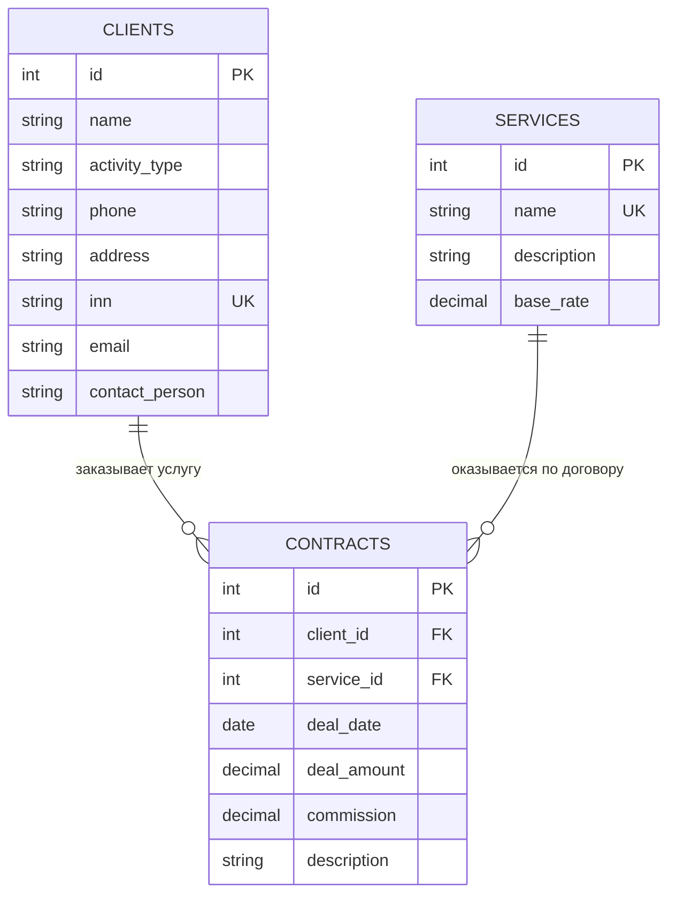

# Лабораторная работа №1. Пункт 1: ER-модель предметной области

## Вариант 7. Нотариальная контора

### 1. Описание предметной области
Нотариальная контора осуществляет предоставление юридических и нотариальных услуг физическим и юридическим лицам и отслеживает финансовую сторону своей деятельности:
- Контора располагает фиксированным перечнем предоставляемых услуг с их описанием и базовыми тарифами.
- При обращении клиентов фиксируются их учетные данные (наименование, вид деятельности, адрес, телефон, ИНН, контактные данные).
- По каждому факту оказания услуги составляется официальный документ (сделка / договор).
- В документе обязательно фиксируются: клиент, оказанная услуга, дата совершения, общая сумма сделки, комиссионные (доход нотариальной конторы) и краткое описание сделки.

---

### 2. Спецификация таблиц реляционной модели

#### Таблица 1: `clients` (Клиенты конторы) — Независимая сущность
Хранит полные учетные и контактные данные клиентов нотариальной конторы.

| Поле | Тип данных | Описание | Ограничения |
| :--- | :--- | :--- | :--- |
| `id` | `INT` | Уникальный идентификатор клиента | `PRIMARY KEY, AUTO_INCREMENT` |
| `name` | `VARCHAR(255)` | Название организации / ФИО гражданина | `NOT NULL` |
| `activity_type` | `VARCHAR(150)` | Вид деятельности (строительство, торговля и др.) | `NOT NULL` |
| `phone` | `VARCHAR(20)` | Контактный номер телефона | `NOT NULL` |
| `address` | `VARCHAR(255)` | Юридический / фактический адрес | `NOT NULL` |
| `inn` | `VARCHAR(12)` | ИНН (10 или 12 цифр) | `NOT NULL, UNIQUE` |
| `email` | `VARCHAR(100)` | Электронная почта | `NOT NULL` |
| `contact_person` | `VARCHAR(150)` | ФИО представителя / контактного лица | `NOT NULL` |

---

#### Таблица 2: `services` (Нотариальные услуги) — Независимая сущность
Каталог услуг, оказываемых нотариальной конторой.

| Поле | Тип данных | Описание | Ограничения |
| :--- | :--- | :--- | :--- |
| `id` | `INT` | Уникальный идентификатор услуги | `PRIMARY KEY, AUTO_INCREMENT` |
| `name` | `VARCHAR(255)` | Наименование нотариальной услуги | `NOT NULL, UNIQUE` |
| `description` | `TEXT` | Подробное описание регламента услуги | `NOT NULL` |
| `base_rate` | `DECIMAL(10, 2)` | Базовый нотариальный тариф | `NOT NULL, CHECK (base_rate >= 0)` |

---

#### Таблица 3: `contracts` (Документы / Сделки об оказании услуг) — Зависимая сущность
Регистрирует факт совершения нотариального действия и оформления документа.

| Поле | Тип данных | Описание | Ограничения |
| :--- | :--- | :--- | :--- |
| `id` | `INT` | Номер нотариального документа / реестровой записи | `PRIMARY KEY, AUTO_INCREMENT` |
| `client_id` | `INT` | Идентификатор клиента | `FOREIGN KEY REFERENCES clients(id)` |
| `service_id` | `INT` | Идентификатор оказанной услуги | `FOREIGN KEY REFERENCES services(id)` |
| `deal_date` | `DATE` | Дата совершения нотариального действия | `NOT NULL` |
| `deal_amount` | `DECIMAL(12, 2)` | Общая сумма сделки | `NOT NULL, CHECK (deal_amount >= 0)` |
| `commission` | `DECIMAL(10, 2)` | Комиссионные (доход нотариальной конторы) | `NOT NULL, CHECK (commission >= 0)` |
| `description` | `TEXT` | Краткое описание предмета сделки | `NOT NULL` |

---

### 3. Обоснование третьей нормальной формы (3НФ)

1. **Первая нормальная форма (1НФ):**
   - Все строки уникальны благодаря первичным ключам `id`.
   - Значения всех атрибутов **атомарны** (неделимы): телефон, адрес, описание хранятся в отдельных столбцах, отсутствуют повторяющиеся группы или составные массивы.

2. **Вторая нормальная форма (2НФ):**
   - Таблицы находятся в 1НФ.
   - Первичный ключ каждой таблицы простой (состоит из одного столбца `id`), отсутствуют составные ключи, поэтому нет частичной функциональной зависимости неключевых атрибутов от первичного ключа. Все неключевые поля функционально полно зависят от первичного ключа.

3. **Третья нормальная форма (3НФ):**
   - Таблицы находятся во 2НФ.
   - **Отсутствуют транзитивные зависимости**: ни один неключевой атрибут не зависит от другого неключевого атрибута ($X \rightarrow Y \rightarrow Z$).
   - Тариф и описание услуги хранятся строго в таблице `services` и зависят только от `service_id`.
   - Реквизиты клиента (адрес, вид деятельности, телефон, ИНН) хранятся исключительно в таблице `clients` и не дублируются в таблице договоров `contracts`. В таблице `contracts` сохраняются только внешние ключи `client_id` и `service_id`.

---

### 4. ER-диаграмма связей

